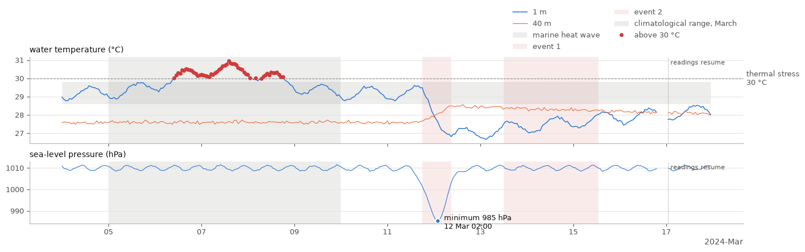
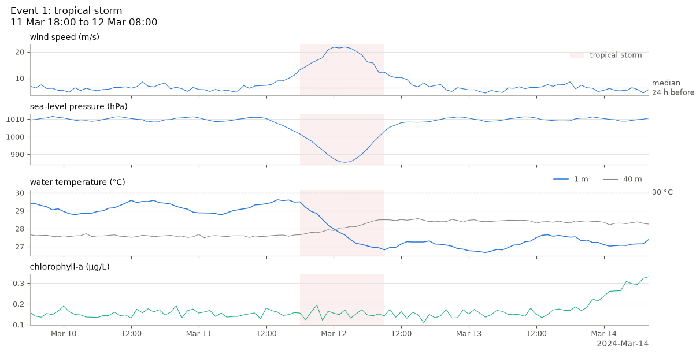
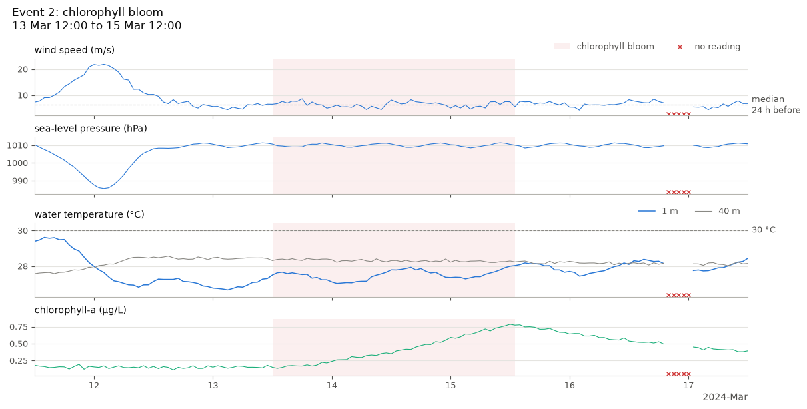

# tspanels

Aligned time series drawn as vertically stacked matplotlib panels that share one time axis. The caller declares the layout (which series are drawn in which panel), the annotations (reference levels, marked times, notes, events, periods), and optionally the gap times and the colors; `plot_panels` draws the figure, including the shared time axis, line colors, panel titles, legends, gap markers, notices for panels without data, grid and axis styling, and date ticks.

The figures below are drawn from synthetic hourly readings of an ocean mooring in a tropical sea; [notebooks/api_walkthrough.ipynb](notebooks/api_walkthrough.ipynb) generates the data and presents the complete API.



*Annotations of one panel (`Band`, `RefLine`, `Points`, `Note`) and of the whole figure (`Span`, `VLine`).*





*One project-level function draws every event with the same layout: a 48-hour window around the event, a `Span` for the event, and gap markers for the hours without a reading.*

The package is intended for time series at any sampling frequency. It contains no assumptions about the data's domain, units, or column names.

## Files

Modules of the package `tspanels` (in `src/tspanels/`):

| File | Holds |
|---|---|
| `style.py` | `Style` (all colors), `DEFAULT_STYLE`, `set_default_style`, `get_default_style` |
| `data.py` | `to_frame`: conversion of pandas, dict, and polars input to a pandas DataFrame indexed by time |
| `layout.py` | `Line`, `Panel`, `as_panels`: the layout of a figure |
| `annotations.py` | `RefLine`, `Points`, `Note`, `VLine`, `Span`, `Band`, and the `Annotation` protocol |
| `plot.py` | `plot_panels`, its building blocks `draw_panel`, `style_axis`, `format_time_axis`, `mark_gaps`, and `required_columns` |
| `theme.py` | `rc_params`, `use_theme`: the look of `plot_panels` for ordinary matplotlib plots |

The public names are imported from the package: `from tspanels import plot_panels, Panel, Line, Style`.

## Installation and tests

The package requires Python 3.13 and is managed with uv. `uv sync` creates the environment, including polars for the tests, and installs the package in editable mode. Another project installs it from a local copy or from GitHub:

```bash
uv add --editable <path to this repository>
uv add "tspanels @ git+https://github.com/dabrowskiknrd/tspanels"
```

Polars input requires the optional dependencies `polars` and `pyarrow`, installed with the extra `tspanels[polars]`. Without them, the package works with pandas input only.

The tests are run with `uv run pytest -q`. They use the non-interactive matplotlib backend `Agg` and display no figures. `tests/test_readme.py` runs the example of this README.

## Example

Ten-minute readings of three signals over three days, with an alarm threshold, a maintenance window, a restart, and gaps in the readings:

```python
import numpy as np
import pandas as pd

from tspanels import Line, Note, Panel, Points, RefLine, Span, VLine, plot_panels

t = pd.date_range("2024-03-01", periods=3 * 144, freq="10min")
rng = np.random.default_rng(1)
data = pd.DataFrame(
    {
        "signal_a": 20 + 5 * np.sin(np.arange(len(t)) / 30) + rng.normal(0, 0.3, len(t)),
        "signal_b": 18 + 5 * np.sin(np.arange(len(t)) / 30 - 0.5) + rng.normal(0, 0.3, len(t)),
        "signal_c": 3 + rng.normal(0, 0.05, len(t)),
    },
    index=t,
)
data["no_reading"] = 0
data.iloc[200:206, :] = np.nan
data.iloc[200:206, data.columns.get_loc("no_reading")] = 1

peak = data["signal_a"].idxmax()
fig, axes = plot_panels(
    data,
    [
        Panel(
            [Line("signal_a", "A"), Line("signal_b", "B")],
            title="signals A and B",
            annotations=[
                RefLine(24, "alarm\n24"),
                Points(data["signal_a"] > 24, "signal_a", "A above alarm"),
                Note(peak, "max {y:.1f} at {x:%d %b %H:%M}", column="signal_a"),
            ],
            height=2,
        ),
        ("signal_c", "signal C"),
    ],
    title="Example data\n1 to 3 March 2024",
    annotations=[
        Span("2024-03-02 06:00", "2024-03-02 09:00", "maintenance"),
        VLine("2024-03-02 09:00", "restart"),
    ],
    gaps="no_reading",
    gap_label="no reading",
)
```

## Input data

`plot_panels(data, panels, time=None, ...)` accepts:

- a pandas DataFrame indexed by time (a `DatetimeIndex`);
- a pandas DataFrame with a time column, named by `time`;
- a `{name: Series}` dict, whose Series are joined on time; a time missing from one Series becomes NaN in that column;
- a polars DataFrame, with `time` naming its time column (required, because a polars DataFrame has no index).

The data is sorted by time; the input is not modified. A time zone of the index is kept. A time given to an annotation without a time zone is interpreted in the time zone of the index, and a time with another time zone is converted to it. Data that is not indexed by time raises `TypeError`, with a message that names the remedy for the input form; data with no rows raises `ValueError`; `time` given together with a dict raises `ValueError`, because the times of a dict are the index of its Series; a column referenced by a panel, an annotation, or `gaps` that the data lacks raises `KeyError`.

Duplicate times are accepted and drawn as given, because recorded data often contains a few double readings and lines and shaded periods are well defined over them. An error is raised only where a duplicate time makes the result undefined: a `Note` without `y` at a time that occurs more than once raises `ValueError`, and so does a boolean Series (`gaps` or a `Points` mask) that has duplicate times and is not indexed exactly like the data. A selection computed from the plotted data itself has the same index and is always accepted, also together with `window`.

## Window

`plot_panels(..., window=(start, end))` plots only the period from `start` to `end`, both included; None for a bound leaves that side at the first or last time of the data. The rows outside the window are removed before drawing, so that the y axes are scaled to the rows inside it and the gap markers cover those rows only. The time axis spans exactly the window, also when the data begins later or ends earlier, and also when an annotation, such as a `Span`, reaches beyond it. The times are interpreted in the time zone of the index, as for annotations. A boolean Series given as `gaps` or as a `Points` mask is aligned to all rows of the data before the window is applied, so that a selection computed from the full data is accepted also when the data repeats a time. A `Note` without `y` whose time lies outside the window raises `KeyError` with a message that names the plotted time range. A window that contains no rows raises `ValueError`. A typical use is a period around an event:

```python
plot_panels(data, layout, window=(start - pd.Timedelta(hours=48), end + pd.Timedelta(hours=48)),
            annotations=[Span(start, end, "event", color="alert")])
```

## Layout

The layout lists the panels from top to bottom. Each `Panel` is one subplot; the `Line` objects of one panel share its y axis.

- `Line(column, label=None, color=None, linewidth=0.8, linestyle="-")`: one column drawn as a line. A line without a label is not listed in the legend.
- `Panel(lines, title=None, annotations=(), height=1.0)`: one subplot. Without a title, a panel with one line is titled with that line's label or column name. `height` is relative to the other panels.

Shorthand forms, converted by `as_panels`:

| Form | Result |
|---|---|
| `"column"` or `Line(...)` | a panel with that one line |
| `("column", "title")` | a panel with one line and a title |
| `{"col_a": "title a", "col_b": "title b"}` | one panel per column |
| `"column"`, `Line(...)`, or `Panel(...)` alone, not in a list | a layout of one panel |

A layout without panels raises `ValueError`. A panel with several lines is always written as `Panel([...])`. A tuple is always read as `(column, title)`, and every other form of item, such as a list of column names, raises `TypeError` instead of being guessed. The pair `("col_a", "col_b")` is ambiguous when `col_b` is also a column, because it may be meant as a second line; `plot_panels` therefore raises `ValueError` for a pair whose title is the name of another column. A title equal to the pair's own column, as in `("volume", "volume")`, and the values of a `{column: title}` dict are not checked, because they are titles without ambiguity.

A legend is drawn above a panel that has two or more labeled items, and in its upper right corner when it has one.

## Annotations

An annotation is attached to one panel (`Panel(annotations=[...])`) or to every panel (`plot_panels(annotations=[...])`).

| Annotation | Draws |
|---|---|
| `RefLine(y, label="")` | a horizontal reference level; the label is placed outside the right edge of the panel |
| `Points(mask, column, label=None)` | markers on `column` at the selected times; `mask` is a boolean Series or the name of a boolean column |
| `Note(x, text, column=None, y=None)` | one marked point with a text label; `{x}` and `{y}` in `text` are replaced by the time and the value |
| `VLine(x, label="")` | a vertical line for an event at one time; the label is placed at the top of the panel |
| `Span(start, end, label=None)` | a shaded period |
| `Band(lower, upper, label=None, fill=True)` | a range between two edges, each a column name or a fixed value, for example control limits; filled, or with `fill=False` drawn as two dashed edge lines |

Every annotation accepts `color`. A color left at None is taken from the style: `RefLine` and `VLine` use `reference`, `Span` uses `shade`, `Points` uses `alert`, `Note` uses the first color of `series`, and `Band` uses `shade` when filled and `reference` for its edge lines.

**User-defined annotations.** Any object with a method `draw(ax, data, style)` is accepted as an annotation; `ax` is the panel's matplotlib Axes, `data` is the full pandas DataFrame being plotted (indexed by time), and `style` is the `Style` in effect. No change to `plot_panels` is required. An annotation that reads columns of the data may also define a method `columns()` that returns their names; `plot_panels` then reports a missing column with `KeyError` before drawing. Without that method, only a `mask` attribute given as a column name and a `column` attribute are recognized.

**Legend entries of figure-wide annotations.** An annotation passed to `plot_panels(annotations=...)` is drawn in every panel, but its legend entry appears in the first panel only, so that the entry is not repeated in every legend. In the panels after the first, the annotation is drawn completely and only its legend labels are removed. This rule applies to every annotation type, including user-defined ones. Text that an annotation writes on the axes, such as the label of a `RefLine` or a `VLine`, is not a legend entry and therefore appears in every panel.

## Colors

All colors are fields of the frozen dataclass `Style`. A figure takes its colors from `plot_panels(style=...)`, or, when that argument is None, from the project-level default set with `set_default_style`. A modified style is created by passing only the fields to change, for example `Style(alert="#c00000")`; `set_default_style(DEFAULT_STYLE)` restores the defaults. A color given explicitly to a `Line` or an annotation takes precedence over the style.

A color given to a `Line` or an annotation may also name a field of the style: `color="alert"` or `color="reference"` takes that field's color, and `color="series[2]"` takes the color at position 2 of `series` (the last color when the position is beyond the end). The color is then taken from the style of the figure when it is drawn, so that it follows `plot_panels(style=...)` and `set_default_style`, which a copied color value such as `DEFAULT_STYLE.alert` does not. `Style.color(value)` performs this lookup and returns every other value, such as `"#c00000"` or `"red"`, unchanged; the field names are not matplotlib color names. A line whose color names a position of `series` is treated like a line with that explicit color: the automatic colors of the other lines skip it.

| Field | Default | Used for |
|---|---|---|
| `series` | `("#2a78d6", "#eb6834", "#1baf7a", "#8a8984")` | line colors, assigned in order to the lines of a panel without an explicit color; colors used explicitly by other lines of the panel are skipped, and the last color is repeated when the colors run out |
| `ink` | `"#0b0b0b"` | figure title, panel titles, `Note` text |
| `ink_muted` | `"#52514e"` | tick labels, legend text, `RefLine` and `VLine` labels, the "no data" notice |
| `axis` | `"#b5b4ae"` | left and bottom axis lines |
| `grid` | `"#e5e4e0"` | horizontal grid lines |
| `reference` | `"#8a8984"` | default color of `RefLine`, `VLine`, and the edge lines of `Band` |
| `shade` | `"#8a8984"` | default fill color of `Span` and of a filled `Band` |
| `alert` | `"#d03b3b"` | gap markers, default color of `Points` |
| `background` | `"white"` | figure and panel face color, edge color of the `Note` marker |

## Gaps

A gap is a time without a reading. A missing value interrupts the line, and `plot_panels(gaps=...)` additionally marks each gap time with a cross along the bottom edge of every panel:

- `gaps=None` (the default): no markers;
- `gaps="column"`: the times where that column is truthy and not missing, for example a column with 1 at gap times and 0 elsewhere;
- `gaps=<boolean Series>`: the times where the Series is True.

The legend entry of the markers is `gap_label` (default `"gap"`), shown in the first panel only.

A gap column that the data lacks raises `KeyError`. With `require_gaps=False`, it draws no markers instead; this suits a project in which only some tables have a gap column. A project fixes such defaults once with `functools.partial`, and every call can still override them:

```python
plot = functools.partial(plot_panels, gaps="gap", require_gaps=False, gap_label="missing hour")
plot(data, layout, width=10)
```

## Required columns

`required_columns(panels, annotations=(), gaps=None)` returns the column names that a layout, its annotations, and `gaps` refer to, computed from the layout alone: for each panel from top to bottom its line columns and then the columns of its annotations, then the figure-wide annotations, then `gaps`, each name once. `plot_panels` applies the same list to check the data before drawing; a caller uses it to select the columns of a figure from a wider table.

## Theme for other plots

`plot_panels` applies its colors explicitly. Other plots of a notebook, such as scatter plots, histograms, or bar charts drawn directly with matplotlib, receive the same look from `use_theme(style=None)`: titles on the left in `ink`, muted tick and axis labels, lines in the `series` colors, a horizontal grid in `grid`, no top or right axis line, and legends without a frame. `use_theme` changes matplotlib's settings (rcParams) for the rest of the process, and `matplotlib.rcdefaults()` restores the defaults. `rc_params(style=None)` returns the same settings as a dict, so that `with matplotlib.rc_context(rc_params()):` applies them to one block of code only. Importing tspanels never changes matplotlib's settings, and the figures of `plot_panels` are identical with and without the theme.
